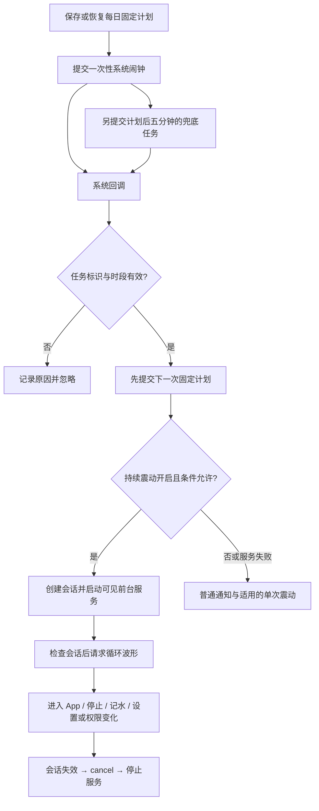

# 饮水提醒技术取证附录

本文件保留日志、系统字段和代码细节，供具体排障时查询。实现原理和设计调整过程请先阅读[主文档](reminder-reliability-postmortem-2026-11-03.md)。

记录日期：2026-11-03。时间均为 Asia/Shanghai（UTC+08:00）。
本文用于后续开发、回归和真机故障排查；补充资料见[提醒行为依据与故障排查](reminder-investigation.md)。

## 1. 当前结果和结论范围

本次在 OnePlus PJA110、Android 16 / API 36、HoshiDrink 1.2.0 上，已经观察到完整链路：

1. App 界面在后台时，15:00 的计划由系统闹钟在 **15:00:12.322** 触发，延迟约 12.3 秒。
2. 持续震动服务成功启动；手机处于静音，规律震动仍然生效。
3. 同一震动会话持续约 **8 分 14 秒**，服务心跳连续，系统没有自行结束循环。
4. 用户进入 App 后，**15:08:26.773** 系统结束震动，原因记录为 `cancelled_by_user`；随后服务销毁。
5. 用户确认“进入 App 后不再震动，现在表现 OK”。

这里的“后台”是 App 界面不可见；持续震动期间的“前台服务”是 Android 的服务运行方式，两者可以同时成立。
本次请求日志明确记录 `foreground=false`，系统服务记录 `createdFromFg=false`、`isForeground=true`，并不矛盾。

之前失败涉及多类原因：旧代码的震动取消路径不完整、前台状态被错误用作震动拦截条件，以及手机系统在后台延后闹钟和任务。
不能把所有现象都归因于手机型号，也不能把一次后台成功等同于所有设备永久保证整点。

## 2. 最终需要保持的产品行为

| 场景 | 当前约定 |
| --- | --- |
| 固定时间 | 以每日开始时间为基准，按间隔生成固定时刻；包含开始、不包含结束 |
| 10:00–18:30，间隔 60 分钟 | 10:00、11:00……18:00；18:30 不提醒 |
| 记录饮水或本次提醒延迟 | 下一次仍对齐固定时刻，不从当前时间重新倒计时 |
| 仅震动 + 持续震动开启 | 到点后规律循环；App 已在前台也允许启动同样的循环 |
| 手机处于静音 | 仍请求震动，不需要额外的“静音时震动”开关 |
| 从后台进入 App | 确认当前提醒并停止震动 |
| 已在 App 内，到点后持续震动 | 通过通知或设置页的“停止震动”、记录饮水等方式确认 |
| 权限或通知渠道关闭、勿扰限制 | 记录原因，不强行绕过系统控制 |
| 关闭提醒、关闭持续震动、切换到不支持循环的提醒方式 | 结束当前循环 |

持续震动只在“仅震动”方式且开关开启时启用。整点预设会设置时段、间隔、震动方式、准时模式并关闭达标暂停；
它不等于自动开启持续震动，持续震动以对应开关的实际值为准。

## 3. 问题、证据和处理方式

### 3.1 仅靠通知震动，静音时可能不震动

早期现象是手机切到振动模式才有震感。普通通知震动由通知渠道、响铃模式和厂商策略共同决定，
应用创建了支持震动的渠道，不代表手机静音时一定执行通知震动。

代码采取的处理：

- 各提醒方式使用稳定且独立的通知渠道，避免应用尝试覆盖用户已经配置的渠道。
- 静音下需要震动时，通知本身静默提交，通过 `Vibrator` 单独发出震动请求，避免重复提醒。
- Android 13+ 使用 `VibrationAttributes.USAGE_ALARM`，更早版本使用 `AudioAttributes.USAGE_ALARM`。
- 保留通知权限、渠道重要性、渠道振动、勿扰和硬件检查；没有修改手机响铃模式，也没有设置绕过限制的 flags。

`USAGE_ALARM` 表示震动用途，不会自动赋予闹钟权限，也不等于任何机型都必须执行。
本次系统记录 `ringerMode=silent`，同时执行了本应用的 ALARM 用途波形，验证了这条路径在本机有效。

### 3.2 进入 App 后偶尔无法停止震动

旧代码存在以下取消覆盖和并发风险，已通过源码及 Git 历史确认：

- 只在带特定 Action 的 `onCreate/onNewIntent` 路径确认提醒。从桌面或最近任务返回，可能只有 `onResume`，漏掉取消。
- 是否调用 `cancel()` 依赖 SharedPreferences 中的 `repeating` 标志。持久化状态不适合充当当前马达所有权的唯一依据。
- 启动与取消可能分别使用不同 Context 获取的震动实例。本机 Android SDK 源码中，这类震动请求和取消与 Binder token 关联；统一所有者可以消除调用端不一致风险。
- 启动前台服务是异步的：用户已经停止，排队中的旧启动仍可能继续执行。
- 旧版本在广播工作中直接持有无限震动，进程结束或被清理可能使循环突然结束。

`SharedPreferences.apply()` 在当前进程会先更新内存、再异步落盘；不能把问题简单解释为“调用 apply 后当前进程立即读不到值”。
这里需要消除的是使用持久化布尔值代替实际会话和震动所有权的设计风险。

这些是代码中发现并修正的问题；旧版偶现故障发生时没有完整事件链，不能声称已逐次证明是哪一项导致了每一次失败。
历史系统震动记录中的 `cancelled_binder_died` 只能证明某些循环因所属 Binder 死亡而结束，不能证明所有取消失败都由这一原因造成。

修正后的实现：

1. `ReminderVibration` 使用 Application Context 缓存同一个 `Vibrator`，统一启动和取消的所有者。
2. 用进程内 `sessionId` 和同步锁管理活动会话，取消不再依赖旧持久化标志。
3. 停止顺序为：使会话失效 → 对同一实例调用 `cancel()` → 停止服务 → 取消服务通知。
4. `MainActivity.onCreate/onNewIntent/onResume` 均覆盖确认入口，重复取消可以安全执行。
5. 服务收到启动时和实际启动波形前，都检查会话仍有效。旧服务销毁时不能取消已经替换的新会话。
6. 循环由 `ReminderVibrationService` 持有，只在提醒期间运行，并提供可见通知和停止按钮。

波形采用约 400 ms 震动、1400 ms 停顿；支持振幅控制时使用 100/180/120 ms 的不同振幅片段，循环索引为 0。
这是一次系统循环震动请求，不是每秒反复调用震动 API。服务每秒检查停止条件，每约 30 秒记录一次心跳。

### 3.3 通知到达了，但 App 在前台时没有震动

11:00 这次有直接日志证据：

```text
11:00:05  界面恢复
11:00:10  收到提醒，source=alarm
11:00:10  震动跳过：用户正在应用内
11:00:10  通知请求已提交，manualVibration=true
11:00:10  短震动跳过，foreground=true，blockedReason=null
```

通知、震动渠道、权限和勿扰检查均通过，但 `startRepeating()` 与 `pulse()` 将“界面已在前台”作为跳过条件，
实际没有调用震动 API。此时“系统通知成功”不能用来证明“震动请求成功”。

最终修改移除了启动持续震动、执行短震动时仅因前台状态而跳过的条件；`beginSession()` 仍检查会话有效性和系统限制。
“已在前台时允许新提醒开始”和“从后台进入前台时停止已有提醒”分别由启动逻辑与生命周期确认处理，不能混为同一个布尔拦截条件。

过程中曾提出前台仅短震动，用户随后明确要求前台也持续规律震动。文档与代码均以最终要求为准，后续不要恢复前台短震动降级规则。

本次自然到点验证针对后台路径；前台移除拦截已完成源码修改，不应把后台成功记录写成前台自然到点也已经单独验证。

### 3.4 后台不提醒，进入 App 后才补发

这部分与前台拦截不同：失败发生在收到系统回调之前。

| 原计划 | 实际处理 | 来源 | 当时界面事件 |
| --- | --- | --- | --- |
| 12:00 | 12:04:25 | 系统闹钟 | 12:03 曾打开 App，12:04:25 再次恢复 |
| 13:00 | 13:41:27.657 | 系统闹钟 | 13:41:27.561 界面恢复 |
| 14:00 | 14:12:47.977 | WorkManager 兜底 | 14:12:47.876 界面恢复 |

应用日志已记录提交精确闹钟，`preciseRequested=true`、`exactAllowed=true`，系统 AppOps 也是 `allow`。
但 14:15 读取系统闹钟服务时，原计划 15:00 的任务出现：

```text
origWhen=2026-11-03 15:00:00.000
window=+35m18s511ms
requester=+44m57s248ms
adjustment=+3d0h44m57s248ms
whenElapsed=+3d0h44m57s248ms
```

`requester` 与 `adjustment` 相比相差 3 天，实际 `whenElapsed` 采用了后者，属于系统层面的调度推迟。
同时，厂商扩展的 `ProxyJob` 列表包含本应用，兜底任务也没有按计划在后台执行。
这不是“App 已收到回调，但忘记发通知”的证据链。

当时还观察到：

- `batteryUnrestricted=false`，电池优化豁免列表没有本应用。
- 原生 `backgroundRestricted=false`，`RUN_ANY_IN_BACKGROUND` 和 `RUN_IN_BACKGROUND` 默认允许，待机桶为 ACTIVE。
- 有 `o-stop(40)` 历史进程退出记录，但 13 点到 14 点使用同一进程会话，不能把这次延迟仅归因于进程死亡。

原生后台限制字段没有覆盖所有厂商策略。`ProxyJob` 是本机系统输出中的扩展状态，不能当作所有 Android 都有的公共 API。
其出现结合实际延迟支持继续排查厂商后台管理；仅靠这一字段不能精确指出哪个菜单开关是唯一原因。

### 3.5 放开后台设置后，系统状态发生了什么变化

给用户的操作指引是：在 HoshiDrink 应用信息的耗电/电池管理中允许后台活动，将电池优化设为不优化或不限制；
若有自启动管理则允许自启动。具体设置由用户在手机上操作，助手只读采集，没有通过 ADB 修改这些开关。

用户确认已开启相关设置，并在应用中重新设置提醒。14:34 再次取证：

| 状态 | 调整前 | 调整后 |
| --- | --- | --- |
| 电池优化豁免 | `batteryUnrestricted=false` | `true`，系统白名单包含本应用 |
| 闹钟额外偏移 | 3 天 | `adjustment=--`，额外偏移消失 |
| 任务代理列表 | 包含本应用 | 本次读取不包含本应用 |
| 下一次计划 | 15:00 | 重新提交 15:00 |
| 系统调度窗口 | 约 35 分 18 秒 | 仍有约 19 分 48 秒，尚未归零 |

可以确认设置变化后，相关系统限制状态改善，随后后台自然到点成功。
由于不是逐项开关的受控实验，不应断言“只打开某一个设置就能解决所有问题”，也不能把用户报告的所有设置逐一视为已由公共 API 验证。

## 4. 最后一次完整链路的证据

### 4.1 后台触发、通知与持续震动

15:01:43 左右采集时，应用日志与系统服务状态能够相互印证：

| 时间或状态 | 证据 |
| --- | --- |
| 15:00:12.313 | 进入闹钟广播接收器 |
| 15:00:12.322 | `收到提醒`，`source=alarm`，`delayMs=12322` |
| 15:00:12.344 | 下一次 16:00 计划已提交 |
| 15:00:12.371 | 启动持续服务，`foreground=false`、`preview=false` |
| 15:00:12.386 | 前台服务通知请求完成，通知 ID 1004 |
| 15:00:12.390 | 持续震动 API 请求提交 |
| 15:00:42 起 | 同一会话每约 30 秒有服务心跳 |
| 系统服务 | `ReminderVibrationService` 在运行，`isForeground=true` |
| 系统震动 | `status=running`、`durationMs=-1`、`endTime=null`、`repeat=0`，调用包名为本应用 |

这次来源是系统闹钟，不是五分钟后的兜底，也不是进入 App 后重排补发。
用户当时确认仍在规律震动，为系统记录提供了实际感知验证。

读取系统波形时，马达瞬时 `currentState=IDLE`、振幅为 0，与循环状态 `running` 可以同时出现，
因为波形包含 1400 ms 停顿。排查时应看 `CurrentVibration`、循环索引和结束时间，不能只截取马达瞬时状态。

### 4.2 进入 App 后结束同一个循环

15:09:43 再次只读采集，补齐停止后的证据：

```text
15:08:17.129  同一会话最后一条心跳
15:08:26.764  Activity 新 Intent，action=OPEN_AND_STOP
15:08:26.765  停止震动请求已提交，同一 sessionId/traceId
15:08:26.768  界面恢复
15:08:26.821  持续服务销毁
```

系统震动历史记录：

```text
start=15:00:12.392
end=15:08:26.773
status=cancelled_by_user
duration≈494383ms
```

约 8 分 14 秒的循环由确认操作结束；后续 `dumpsys activity services com.hoshi.drink` 返回没有活动服务。
这里 `cancelled_by_user` 是系统对取消的分类，结合 Activity 和取消日志判断由本应用确认流程触发，不能仅凭名称推断某个物理按键。
服务销毁后出现“忽略旧会话停止请求”是当前会话已被清空的正常记录，不表示取消失败。

## 5. 代码修改、用户操作和只读排查的边界

### 5.1 已实施的代码和工具调整

| 位置 | 修改目的 |
| --- | --- |
| [ReminderPolicy.kt](../app/src/main/java/com/hoshi/drink/ReminderPolicy.kt) | 用固定时刻生成计划，结束时间不包含在内；去重、时段与达标规则集中处理 |
| [Reminders.kt](../app/src/main/java/com/hoshi/drink/Reminders.kt) | 先安排下一次再发送本次通知；记录闹钟标识、计划/回调时间；选择精确或普通 API；保留 WorkManager 兜底 |
| [ReminderVibration.kt](../app/src/main/java/com/hoshi/drink/ReminderVibration.kt) | Application 级震动实例、会话锁、取消时先失效；静音下直接请求震动；允许前台启动循环 |
| [ReminderVibrationService.kt](../app/src/main/java/com/hoshi/drink/ReminderVibrationService.kt) | 提醒期间持有循环；启动和停止条件检查、心跳、失败降级、销毁清理 |
| [MainActivity.kt](../app/src/main/java/com/hoshi/drink/MainActivity.kt) | 补齐生命周期确认入口，提供停止、诊断查看和 ZIP 导出入口 |
| [DrinkViewModel.kt](../app/src/main/java/com/hoshi/drink/DrinkViewModel.kt) | 记录设置与数据操作；记录饮水、相关设置变更时确认提醒 |
| [DrinkApplication.kt](../app/src/main/java/com/hoshi/drink/DrinkApplication.kt) | 进程启动、系统状态变化、历史退出原因和未捕获异常记录 |
| [ReminderDiagnostics.kt](../app/src/main/java/com/hoshi/drink/ReminderDiagnostics.kt) | 有界异步文件日志、轮转、事件关联、状态采样、异常堆栈和导出 |
| [AndroidManifest.xml](../app/src/main/AndroidManifest.xml) | 注册 Application、广播与持续震动的 `specialUse` 前台服务及对应权限 |
| [collect-reminder-logs.sh](../scripts/collect-reminder-logs.sh) | 只读拉取应用文件及相关系统状态，支持指定设备和输出目录 |

前面的架构和功能调整涉及多次开发，并非全部都发生在 15 点验证前的最后一次修改。
Git 历史中可参考：`35edc01`（整点和持续震动）、`b072496`（取消与调度诊断）、`331f0fb`（文件日志及导出）。
允许前台持续震动及修正采集脚本输出的后续修改见 `7292caa`；本次取证期间不同运行状态均报告版本名 1.2.0，不能仅用版本名精确推断手机安装了哪个源码状态。

本次采集时还发现并修复取证脚本末行的变量边界问题：`$output_dir。` 改为 `${output_dir}。`。
另将设备参数封装为函数，避免 macOS Bash 的空数组与 `set -u` 兼容问题。
这些影响电脑端采集体验，不是手机漏提醒的原因。

### 5.2 用户在设备上进行的操作

用户负责通过 IDE 更新安装、调整通知/后台相关系统设置、重新开启和保存提醒，并实际观察到震动与停止。
助手没有远程更改响铃模式、电池白名单、自启动设置或系统闹钟策略。
本次取证未用 ADB 发出测试震动、打开 Activity、强停应用或清空 Logcat。

### 5.3 验证记录的表述要求

遵照项目 `AGENTS.md`，助手未运行构建、编译、测试或 lint。用户的自然到点观察和只读系统日志采集是本次验证依据。
写“源码已调整”“API 请求已提交”“系统正在执行”“用户实际感知”时，应分别注明证据，避免相互代替。

## 6. 当前调度和会话设计，后续修改时应保留



需要保留的实现原则：

1. **只认一次有效任务。** 系统闹钟与兜底共享任务标识；本次消费后更新标识，旧回调不能重复发通知。
2. **先排下一次。** 当前通知或震动失败，不应因此中断后续调度；异常路径不要回写已经消费的旧任务。
3. **不用后台线程冒充精确闹钟。** WorkManager 是恢复机会，不能保证某分钟准时；本次它也受系统限制。
4. **取消要同步失效。** 先清空当前会话，再取消马达，让已排队的服务启动无法复活旧循环。
5. **所有入口使用同一个震动所有者。** Activity、Receiver、Worker、Service 不分别缓存互不关联的实例。
6. **允许前台到点启动。** 生命周期进入前台负责确认旧提醒，不能因此禁止 App 已在前台时开始新提醒。
7. **前台服务只覆盖提醒期间。** 不为整点调度常驻保活；进程退出后也不无限重启循环。
8. **广播短时持有 CPU。** `goAsync()` 本身不等于 CPU 保持唤醒；当前短锁最长 10 秒，完成即释放，并保证 `PendingResult.finish()`。
9. **持续震动不越过系统控制。** 服务检查权限、渠道、勿扰与方式变更，出现限制或错误就结束。

## 7. 为什么可以不打开 App 就读取“后台现场”

电脑通过已授权的 ADB 连接手机，读取两层独立信息：

- 应用在后台或前台执行过的事件，已写入应用私有文件；读取文件不需要让 Activity 恢复。
- Android 系统服务持有的闹钟、任务、通知、震动与进程历史，可通过 `dumpsys` 查询。

调试包允许 `run-as` 切换到应用身份读取私有文件，例如：

```sh
adb exec-out run-as com.hoshi.drink tar -cf - files/diagnostics > app-logs.tar
adb shell dumpsys alarm
adb shell dumpsys jobscheduler
adb shell dumpsys vibrator_manager
adb shell dumpsys activity services com.hoshi.drink
adb shell dumpsys activity exit-info com.hoshi.drink
```

正式非调试包通常不能使用 `run-as`，需要应用内“导出完整日志”。应用文件只包含已落盘的事件；
进程直接被杀时最后排队的日志可能丢失，系统退出记录可辅助补充。

“现场”不是全机原子快照：各命令依次运行，日志和系统状态会继续变化。USB 连接/充电也可能改变休眠条件，
分析时应同时保留设备时间、电源与亮屏状态。本次启动震动发生在采集前，读取命令没有触发提醒。

当前日志设计：7 个约 1 MiB 的 JSONL 轮转文件，`events-0.jsonl` 最新；界面仅展示最近 150 条。
包含日期时区、开机后时间、PID/TID、进程会话、事件、结构化字段、单条最多 24,000 字符的异常堆栈。
写入队列容量 2048，过载丢弃计数记入下一条 `droppedSinceLastWrite`；不记录饮水明细，不自动上传。

同一次提醒用 `alarmId/traceId` 关联；循环用 `sessionId` 关联；重启用 `processSession` 区分。
后台快照按实际采样时间解读，不能假设所有字段都采自更早那一条事件的瞬间。

## 8. 下次故障的排查顺序

### 8.1 先保留现场

用户反馈“后台没提醒”时，先不要打开、强停、重装或清除 App 数据，也不要先清空 Logcat。
进入 App 会触发生命周期确认和计划恢复，可能立即补发，改变待分析的状态。

从仓库根目录执行已提供的只读脚本：

```sh
bash scripts/collect-reminder-logs.sh
# 多台设备时：
bash scripts/collect-reminder-logs.sh DEVICE_SERIAL diagnostics/incident-name
```

只有在用户允许连接并授权调试后读取设备。不要为取证自行变更电池白名单、后台限制、通知或勿扰设置。

### 8.2 按阶段定位，避免直接改震动代码

| 观察结果 | 优先核对 |
| --- | --- |
| 没有提交计划 | 设置是否保存、提醒是否开启、计划恢复是否失败 |
| 有计划，系统没有对应闹钟 | 系统是否取消、强停、权限撤销、更新或计划覆盖 |
| 有闹钟，没有广播入口 | 系统实际 `whenElapsed`、`window`、`adjustment`、休眠与厂商后台策略 |
| 有兜底，仍没执行 | 系统任务约束、代理或冻结状态；不能把“提交成功”当成“已执行” |
| 广播入口后没有处理完成 | 短锁、线程调度、异常堆栈与耗时 |
| 已处理，没有通知 | 时段/达标规则、通知权限与渠道、API 失败记录 |
| 有通知，没有震动请求 | 方式与持续开关、`blockedReason`、是否遗留前台拦截 |
| 震动请求成功，用户无震感 | 系统是否正在执行/忽略，波形、振幅、用途、强度和设备策略 |
| 进入 App 仍在震动 | 生命周期确认、相同会话的取消、旧服务启动是否被失效、系统取消分类 |

系统日志含义：

- `exactAllowed=true` 证明权限检查通过，不能证明系统最终保留了零窗口。
- `backgroundRestricted=false` 不代表所有厂商后台管理都放行。
- `batteryUnrestricted=true` 代表电池优化豁免，不等于所有厂商限制和 Doze 行为都无效。
- `status=running` 证明系统仍持有循环；瞬时 `IDLE` 可能是正常停顿。
- 通知的 `vibrate=null` 不代表持续震动失败：当前通知静默，由 `Vibrator` 独立执行循环。
- 本次 Logcat 文件为空，但持久化 JSONL 正常；不要只凭 Logcat 空文件推断 App 没有执行。

### 8.3 需要额外证据时

脚本对系统输出做了筛选，厂商格式不同可能遗漏字段。本次曾额外读取完整闹钟服务和任务服务，
才看清 3 天偏移和 `ProxyJob` 列表；查询 `dumpsys jobscheduler com.hoshi.drink` 在本机仍返回了大量全局信息，
不能假设附加包名就一定实现服务端过滤。仅在需要时采集，并在展示或分享前筛选本应用相关内容。

当前震动波形也可以额外读取完整 `CurrentVibration` 部分，避免脚本仅匹配包名时遗漏其上方的状态和波形。
比较时记录每次命令时间，不把两次采样中间发生的变化当成矛盾。

## 9. 证据保存位置与提交范围

以下为本机仓库下的相对位置，`diagnostics/` 已由 Git 忽略；新克隆的仓库不会自动包含这些文件。
本文保留了关键时间与必要字段，便于原始文件不存在时仍理解结论。原始诊断包含设备状态，分享前应检查内容。

| 目录 | 用途与重点文件 |
| --- | --- |
| `diagnostics/20261103-110125/` | 前台不震动：`events-0.jsonl` 中明确跳过持续和短震动 |
| `diagnostics/20261103-141426/` | 后台延迟：`events-0.jsonl`、`alarm-full.txt`、`jobs.txt`、`process-exits.txt` |
| `diagnostics/20261103-143402/` | 设置调整后：`events-0.jsonl`、`alarms.txt`、`alarm-followup.txt`、`job-proxy.txt` |
| `diagnostics/20261103-150144/` | 后台成功与持续震动：`events-0.jsonl`、`services.txt`、`current-vibration.txt` |
| `diagnostics/20261103-150943/` | 进入 App 后取消：`events-0.jsonl`、`vibration.txt`、`services.txt` |

开发文档和采集脚本可随源码提交；原始私有日志、全局 dumpsys 和临时归档不应混入普通功能提交。

## 10. 尚未解决或尚未覆盖的事项

- **系统窗口仍非零。** 15:00 实际晚约 12 秒；后续 16:00 闹钟仍显示约 44 分 50 秒窗口，但没有 3 天偏移。
  本次不能解释厂商为何保留该窗口，也不能把窗口长度当作这次已经延迟的时长。
- **成功样本有限。** 验证了本机本次后台触发、静音持续震动及进入 App 停止；未覆盖长时间不充电休眠、重启、多天运行、全部机型和全部停止入口。
- **前台自然到点需独立回归。** 对前台的代码拦截已移除，不能用后台成功代替这一项验证。
- **安装版本追溯不足。** 后续应增加构建标识或源码版本字段；相同 `versionName` 不能说明安装二进制相同。
- **界面措辞可改善。** 当前“实际调度：精确闹钟”来自应用提交 API 后保存的模式，不是从系统读取的真实窗口；后续宜改为“请求的调度方式”并解释边界。
- **配置快照仍可补强。** 当前设置日志记录变化字段名，快照覆盖提醒配置但不包含所有设置值；后续如增加字段，仍避免写入饮水记录明细。
- **发布渠道需另行确认。** `specialUse` 前台服务在 Google Play 的申报与审核不由本次真机运行结果保证。

未来需要回归的场景：前台自然到点、后台亮屏、后台锁屏、静音/振动/响铃、长时间休眠、各入口停止、
通知/精确权限撤销、时区或时间变化、覆盖安装及重启恢复。这里只列出开发参考，不表示已执行，
也不改变项目“未经用户明确要求，不运行构建、编译、测试或 lint”的约定。

## 11. 参考资料

以下链接继承此前调研与本机源码阅读结果，本次文档整理没有重新在线核验页面：

- [Android 闹钟调度](https://developer.android.com/develop/background-work/services/alarms)
- [Activity 生命周期](https://developer.android.com/guide/components/activities/activity-lifecycle)
- [前台服务后台启动限制](https://developer.android.com/develop/background-work/services/fgs/restrictions-bg-start)
- [specialUse 前台服务类型](https://developer.android.com/develop/background-work/services/fgs/service-types#special-use)
- 本机 Android SDK 35 源码：`android/os/SystemVibratorManager.java`，用于理解同一所有者的请求和取消。
- 同类产品公开行为与参考链接见[已有调研](reminder-investigation.md#同类产品的可确认行为)。商业应用的内部调度代码未公开，不能宣称已确认它们使用了与本应用相同的实现。
